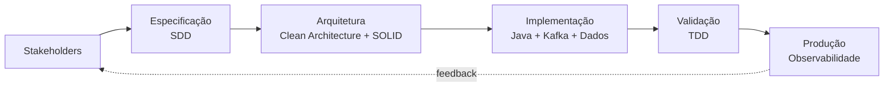

# Juliana Chaves Palm

### Software Engineer · Solution Design & SDD · Data Analytics & IA · Backend Java de Alta Escala

---

## O que eu entrego

> Engenheira de software que transforma **necessidades de negócio em soluções técnicas end-to-end** — da especificação à implementação, com arquitetura sólida, dados e IA integrados.

Não entrego apenas código. Entrego **soluções desenhadas, especificadas, implementadas, testadas e observáveis**, com rastreabilidade entre a demanda do stakeholder e a entrega em produção.

| Entrega | Como | Evidência |
|---|---|---|
| **Desenho de soluções end-to-end** | Recebo demandas de stakeholders e conduzo arquitetura + especificação com **Spec-Driven Development (SDD)** | Ciclo completo: especificação → arquitetura → implementação → validação |
| **Backend de alta escala** | **Java**, Spring Boot, microsserviços, **Kafka**, concorrência e paralelismo distribuído | Sistemas críticos do setor financeiro |
| **Dados & IA aplicados** | **DuckDB/BigQuery**, Feature Stores, inferência estatística, ML e agentes de IA | Modelagem analítica preditiva e IA no ciclo de desenvolvimento |
| **Qualidade e estabilidade** | **TDD**, Clean Architecture, SOLID, observabilidade, war rooms | Serviços sustentáveis, testados e observáveis |

---

## Como eu trabalho

**Cada prática tem uma função clara no ciclo:**
- **SDD** conduz o ciclo de **especificação e arquitetura** — o *quê* e o *porquê*, antes do código.
- **Clean Architecture** e **SOLID** estruturam o **código** — o *onde* e o *como*, com baixo acoplamento.
- **TDD** valida o **comportamento das regras de negócio** — a garantia de que a entrega funciona e não regride.
- **Observabilidade** garante que a entrega **permanece estável** em produção.

---

## Stack e competências

<table>
<tr>
<td valign="top" width="50%">

### Solução & Processo
- Desenho end-to-end a partir de stakeholders
- **Spec-Driven Development (SDD)**
- Colaboração em tríade com Data Science e Data Analytics
- IA aplicada ao ciclo: **GitHub Copilot, Claude Code, Codex**

### Backend & Distribuídos
- **Java**, Spring Boot, APIs REST
- Microsserviços e integração assíncrona
- **Kafka**, resiliência, idempotência
- Concorrência e paralelismo distribuído

</td>
<td valign="top" width="50%">

### Dados & IA
- **DuckDB**, **BigQuery** e Lakehouse colunar
- **PostgreSQL**, **MySQL**, chave-valor
- Feature Stores, Machine Learning e Agentes de IA
- Inferência estatística e testes de hipótese

### Engenharia & Arquitetura
- **Clean Architecture**, **SOLID**, **TDD**
- Testes: RestAssured, Pytest, Appium/Maestro
- Observabilidade, alertas, war rooms
- CI/CD: GitHub Actions, Azure DevOps

</td>
</tr>
</table>

---

## Experiência em destaque

### Capgemini · Engenharia de Software
**Entregas principais:**
- **Desenho de soluções end-to-end** a partir de demandas de stakeholders, com arquitetura e especificação via **SDD**.
- Atuação em **Data Analytics e IA**, em colaboração com times de Data Science e Data Analytics.
- Desenvolvimento de **sistemas críticos do setor financeiro**, com backend Java e integrações assíncronas.
- Arquitetura e implementação de **GitHub Copilot Extensions**, levando IA ao ciclo de desenvolvimento.
- Arquiteturas de **dados sintéticos em larga escala** (DB2, Javelin).
- Liderança técnica em **prevenção de falhas** e automação ponta a ponta.

---

## Projetos em destaque

<table>
<tr>
<td width="33%" valign="top">

### afrobank-ledger
Core bancário de liquidação financeira e conta-corrente com **Java 17, Spring Boot e Kafka**.

- **Anti-Deadlock:** Locks pessimistas ordenados (`SELECT FOR UPDATE`).
- **Transactional Outbox:** Mensageria assíncrona via Kafka com DLQ.
- **Idempotência:** `X-Idempotency-Key` (RFC 7807) e `BigDecimal (HALF_EVEN)`.
- **Qualidade:** 17 testes automatizados de domínio e contratos REST.

**Evidência:** Backend financeiro crítico, resiliência e concorrência distribuída.

</td>
<td width="33%" valign="top">

### playbook-analytics
Plataforma de inteligência analítica e modelagem preditiva com **Python, DuckDB e ML**.

- **Lakehouse Colunar:** DuckDB e Parquet otimizado com query de eventos SQL.
- **Feature Store & Rigor:** Teste T de Student comprovando mando de quadra ($p < 0.05$).
- **Machine Learning & Agente:** Win Probability calibrada e agente tático de IA.
- **Qualidade:** **96% de cobertura** e CI no GitHub Actions.

**Evidência:** Data Analytics & IA, Feature Store, modelagem estatística e MLOps.

</td>
<td width="33%" valign="top">

### acordes
Guia normativo de teoria harmônica e áudio acústico com **Zero Runtime Dependencies**.

- **Governança SDD:** 12 ADRs e 10 Especificações de Features em `.specs/`.
- **A11y WCAG 2.1 AAA:** Falsa tabela ABNT, semântica DPUB e silêncio auditivo.
- **Domínio Puro:** Teoria harmônica isolada do DOM e pool de 26 amostras reais.
- **Qualidade:** **96.6% de cobertura** em runner nativo (`node --test`).

**Evidência:** Solution Design, Spec-Driven Development (SDD) e A11y Assistive-First.

</td>
</tr>
</table>

---

## Em constante evolução

- **Streaming de telemetria, processamento batch e feature stores em tempo real**.
- **Modelos e agentes de IA integrados a pipelines de dados analíticos**.
- **Metodologias estatísticas aplicadas às ciências humanas e esportivas** — unindo análise de dados sociais e inovação tecnológica.

---

## Vamos conversar?

Aberta a oportunidades em **engenharia de backend, design de soluções e sistemas de dados**.

---

README construído para traduzir entregas, não apenas tecnologias.

